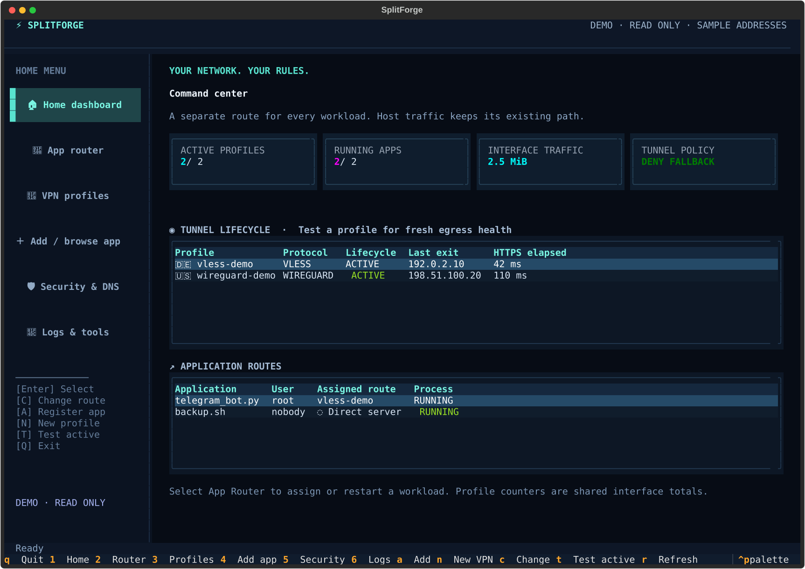
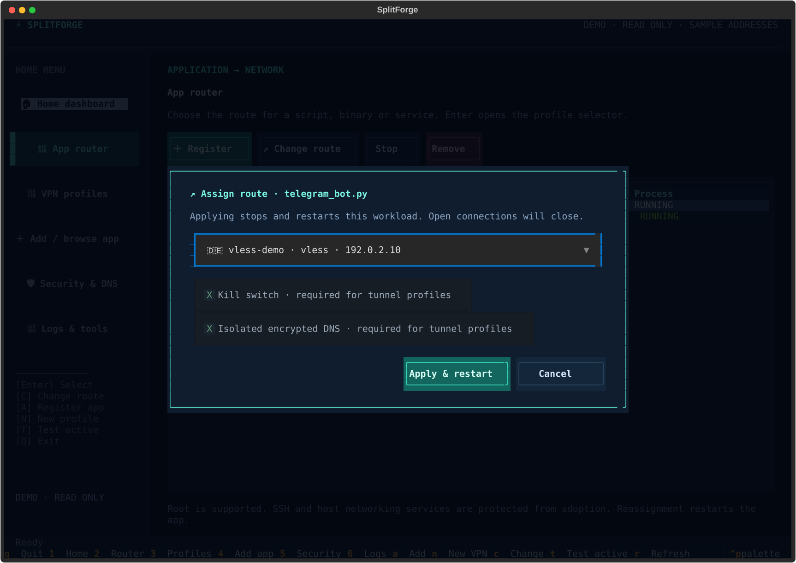
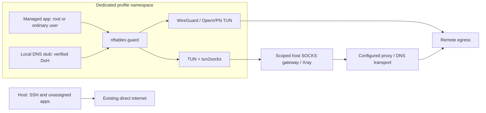

<div align="center">

# ⚡ SplitForge

### One terminal. Many tunnels. A network path for every app.
### مسیر اینترنت هر برنامه را جداگانه انتخاب کنید.

[](LICENSE)
[](pyproject.toml)
[](docs/GETTING_STARTED.md)
[](https://github.com/EclipseOfficialDota/SplitForge/actions/workflows/ci.yml)

**Per-application split tunneling with a Textual dashboard, systemd supervision,
network namespaces, encrypted DNS and fail-closed routing. Root workloads supported.**

[راهنمای کامل فارسی](docs/README.fa.md) · [Installation & tutorial](docs/GETTING_STARTED.md) ·
[Protocols](docs/PROTOCOLS.md) · [Validation record](docs/VALIDATION.md) ·
[Troubleshooting](docs/TROUBLESHOOTING.md)

</div>



Actual application screenshot. Demo addresses, flags and measurements are
illustrative; demo mode makes no network changes.

## Install

On Ubuntu/Debian with systemd, Python 3.10+, TUN and root access:

```sh
git clone https://github.com/EclipseOfficialDota/SplitForge.git && cd SplitForge && sudo bash install.sh
```

The installer creates `/opt/splitforge/venv`, installs distribution networking
tools and SHA-256-verified Xray/tun2socks binaries, and provides
`/usr/local/bin/splitforge`. Read [the installation guide](docs/GETTING_STARTED.md)
for prerequisites, upgrades, dependency pins and removal. VPN credentials and
remote servers are not included.

```sh
sudo splitforge doctor
sudo splitforge               # Full terminal control panel
splitforge --demo             # Read-only preview; no root required
splitforge --help
```

Ubuntu 22.04/24.04 and Debian 12/13 are installation targets. The recorded Linux
integration environment is Ubuntu 24.04 under WSL2 with systemd and TUN enabled;
this is not a claim of completed tests on every distribution/kernel.
Native Windows/macOS cannot run the networking engine.

## Route your first application

Store a real provider configuration privately, then:

```sh
sudo splitforge profile import /root/profiles/client.conf --name wg-europe
sudo splitforge profile start wg-europe
sudo splitforge profile test wg-europe
sudo splitforge exec --profile wg-europe --user root -- /usr/bin/python3 /root/bot.py
```

For a supervised application that continues after closing the terminal:

```sh
sudo splitforge app add telegram-bot --user root --cwd /root/bot -- /root/bot/venv/bin/python /root/bot/main.py
sudo splitforge bind telegram-bot --profile wg-europe
sudo splitforge bind telegram-bot --profile direct
sudo splitforge app stop telegram-bot
```

Changing a route **restarts** the selected managed application. Existing TCP
sessions, process memory and unfinished work do not migrate. Unregistered apps
continue using their existing network. SSH/network infrastructure services are
protected against adoption.

## The terminal experience

| Screen | Controls |
| --- | --- |
| Home dashboard | Tunnel/application counters, shared bandwidth, lifecycle and last egress measurements |
| App router | Choose Direct or a profile; apply restart-based reassignment |
| VPN profiles | Import, replace a stopped profile, start, stop, test, remove; DNS-tunnel wizard |
| Add / browse app | File tree, process command picker, existing service picker and command form |
| Security & DNS | Enforced namespace guards and per-profile verified DNS-over-HTTPS |
| Logs & tools | Live SplitForge journal and dependency installation |

Keyboard: **1–6** switch pages, **A** register app, **N** new profile,
**C** choose route, **T** test active profiles, **R** refresh, **Q** exit.
Use Tab/arrows/Enter or mouse clicks; Escape cancels dialogs. A terminal of
120×40 or larger is recommended; compact 80×24 mounting is tested.

```text
╭─ ⚡ SPLITFORGE ───────────────────────────────────────────╮
│ HOME MENU           │ APPLICATION → NETWORK               │
│ Home dashboard      │ telegram_bot.py → WireGuard         │
│ App router          │ scraper.py      → VLESS / REALITY   │
│ VPN profiles        │ backup.sh       → Direct            │
│ Add / browse app    │                                    │
│ Security & DNS      │ Select app → profile → Apply         │
│ Logs & tools        │ Root and ordinary users supported   │
╰──────────────────────────────────────────────────────────╯
```



## Protocol support

| Adapter | Import | Dependencies | Boundary |
| --- | --- | --- | --- |
| VLESS / REALITY | `vless://`, Xray JSON | Xray + tun2socks | Server/transport compatibility required |
| VMess | `vmess://`, Xray JSON | Xray + tun2socks | Base64 VMess JSON supported |
| Trojan | `trojan://`, Xray JSON | Xray + tun2socks | TLS verification enabled by default |
| Shadowsocks | `ss://`, Xray JSON | Xray + tun2socks | URI plugins rejected |
| SOCKS5 | `socks5://`, `socks://`, Xray JSON | Xray + tun2socks | UDP requires an upstream UDP relay |
| WireGuard | `.conf` | wireguard-tools | IPv4 default peer required; hooks rejected |
| OpenVPN | `.ovpn` | openvpn | TUN clients; strict option allow-list |
| DNSTT | Wizard / `profile dns-tunnel` | dnstt-client + Xray + tun2socks | TCP to a remote SOCKS5 server |
| Slipstream | Wizard / `profile dns-tunnel` | slipstream-client + Xray + tun2socks | TCP; remote SOCKS5 and pinned PEM certificate |

See [protocol setup](docs/PROTOCOLS.md). Adapters are implemented; the
[validation matrix](docs/VALIDATION.md) distinguishes real Linux exercises from
protocols needing validation against your upstream. Importing configuration
does not prove connectivity. Cores are separate upstream projects.

## How traffic is isolated



- Each active profile owns `ns-<id>`, a veth pair and scoped firewall/routing resources.
- The engine does not write the host main routing table, flush global firewall
  rules or change host IP forwarding. It does create dedicated host policy
  tables/rules and owned nftables tables.
- Namespace output denies underlay fallback. DNS uses a local stub forwarding
  verified HTTPS through the tunnel. IPv6 is disabled in managed namespaces.
- Kill switch and DNS isolation are mandatory for shared tunnel namespaces;
  independent disabling would weaken all applications sharing that profile.
- Root workloads are supported with capabilities removed and privilege
  escalation restricted. Use trusted programs: a network namespace is not a
  complete filesystem or hostile-code sandbox.
- User binding affects future ordinary-account `systemd --user` workloads;
  it does not intercept arbitrary existing processes or root's SSH sessions.
- `--proxychains` is an optional TCP wrapper with weaker isolation guarantees.

See [architecture](docs/ARCHITECTURE.md) and [security](SECURITY.md). No tool can
guarantee that unrelated host firewall, provider or kernel changes never affect SSH.

## Operations

```sh
sudo splitforge status --json
sudo splitforge logs --follow
sudo splitforge dependencies list
sudo splitforge profile stop wg-europe
sudo splitforge profile import /root/profiles/new.conf --replace wg-europe
sudo splitforge restore
```

Replacement requires a stopped profile and retains its ID, app references,
DNS and probe configuration. Profile start and generated app binding enable
their systemd units for boot. `restore` reapplies saved enabled assignments.
Rehearse provider-specific behavior and reboot recovery on your server before
depending on unattended recovery.

## فارسی — شروع سریع

این نسخه رابط کامل ترمینال، CLI، نصب‌کننده، ذخیرهٔ وضعیت و اجرای برنامه با root
یا کاربر عادی دارد. بعد از نصب، `sudo splitforge` را اجرا کنید؛ در VPN Profiles
پروفایل را وارد و آزمایش کنید، برنامه را ثبت کنید و از App Router مسیرش را انتخاب کنید.
تعویض مسیر با ری‌استارت برنامه انجام می‌شود. IPv6 داخل namespace غیرفعال است؛
DNSTT و Slipstream در این آداپتور TCP هستند و SOCKS5 سمت مقابل لازم دارند.
آزمون واقعی لینوکس، WireGuard، SOCKS5، DNS رمزگذاری‌شده و اجرای root ثبت شده است؛
تأیید همهٔ سرویس‌دهنده‌های عمومی یا ریبوت همهٔ توزیع‌ها ادعا نمی‌شود.
[آموزش کامل فارسی](docs/README.fa.md).

## Documentation and development

| Guide | Contents |
| --- | --- |
| [Getting started](docs/GETTING_STARTED.md) | Installation, root scripts, services, upgrades and cleanup |
| [فارسی](docs/README.fa.md) | آموزش قدم‌به‌قدم و مدیریت سرور |
| [Protocols](docs/PROTOCOLS.md) | Provider files, URI formats and DNS tunnels |
| [Architecture](docs/ARCHITECTURE.md) | Routing ownership, guards and lifecycle |
| [API](docs/API.md) | Python models and methods |
| [Troubleshooting](docs/TROUBLESHOOTING.md) | Logs, permissions, DNS and recovery |
| [Validation](docs/VALIDATION.md) | Reproducible checks and coverage limits |
| [Security](SECURITY.md) | Root trust model and reporting |
| [Contributing](CONTRIBUTING.md) | Development setup and CI |

```sh
python3 -m venv .venv
.venv/bin/pip install -c requirements.lock -e .
.venv/bin/python -m unittest discover -s tests -v
```

Privileged integration tests are opt-in; use an isolated Linux lab as described
in [Validation](docs/VALIDATION.md). Report sanitized issues on
[GitHub](https://github.com/EclipseOfficialDota/SplitForge/issues).
SplitForge uses the [MIT License](LICENSE); upstream cores retain their licenses.
