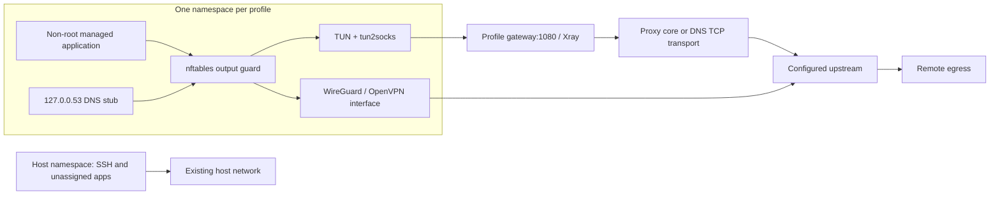

<div align="center">

# ⚡ SplitForge

### Give each application its own network path.
### مسیر اینترنت هر برنامه را جداگانه انتخاب کنید.

[](LICENSE)
[](docs/GETTING_STARTED.md)
[](docs/ARCHITECTURE.md)
[](#project-status)

**Per-application split tunneling for Ubuntu/Debian VPS hosts.**

[راهنمای کامل فارسی](docs/README.fa.md) · [Hands-on tutorial](docs/GETTING_STARTED.md) ·
[Protocols](docs/PROTOCOLS.md) · [Architecture](docs/ARCHITECTURE.md) ·
[API reference](docs/API.md) · [Troubleshooting](docs/TROUBLESHOOTING.md)

</div>

---

## Project status

**This repository currently ships Part 1: the Python networking backend.**
There is no public `splitforge` command, Textual UI, `install.sh`, or
`pyproject.toml` yet. The internal module entry points serve systemd helpers;
they are not the planned user-facing CLI.

The source implements profile storage/import, network namespaces, firewall and
DNS guards, systemd execution, and application reassignment. Live VPN, kernel
firewall, reboot, and systemd integration have **not** been verified on Linux.
There is no production-readiness or zero-SSH-interruption certification.

Latest recorded local result: **9 tests passed, 1 Linux-only test skipped** on
Windows with Python 3.13. The networking tests inspect generated commands using
mocks; they do not establish a VPN connection. No CI result is implied by the
badges above. See [validation details](docs/GETTING_STARTED.md#validation-levels).

## What SplitForge is for

Imagine a VPS with a Telegram bot, scraper, backup script, and a normal SSH
session. SplitForge's intended workflow is:

```text
telegram_bot.py ──► WireGuard profile
scraper.py      ──► VLESS / REALITY profile
backup.sh       ──► OpenVPN profile
another app     ──► Direct server internet
SSH / host      ──► Existing host network
```

Each selected profile receives a dedicated Linux network namespace. Managed
workloads start inside that namespace, and their children inherit it. Changing
the assignment stops the managed workload and starts it again with the new
namespace. Existing TCP connections and in-memory application state do not
survive this restart.

Unregistered applications are not automatically moved or wrapped. SplitForge is
not a VPN server provider, a DNS-tunnel server installer, or a container network
controller.

## Capabilities and boundaries

| Area | Present in the backend | Boundary today |
| --- | --- | --- |
| Profiles | URI, WireGuard, OpenVPN and single-outbound Xray imports | Import success does not prove reachability |
| Isolation | One namespace per active profile; IPv4 routes and nftables guards | IPv6 data-plane traffic is disabled |
| Host routing | Veth peer routes use dedicated tables and destination rules | Host addresses, policy rules and owned nftables tables are still changed |
| Applications | Persistent generated systemd services and one-off execution | Workloads must use a non-root Linux account |
| Existing services | Managed namespace drop-in for an eligible service | Explicit non-root `User=`; socket-activated services are rejected |
| Reassignment | Stop, update unit, start, and attempt rollback on failure | Restart-based; no live process or connection migration |
| DNS | Namespace-local UDP/TCP stub forwards to HTTPS with TLS verification | Requires reachable configured DoH endpoint through the tunnel |
| Kill switch | Namespace output defaults to deny; no general veth forwarding | Shared namespaces require both kill switch and DNS isolation |
| User binding | Drop-in for a non-system `user@UID.service`; wrapper mapping | Future user-manager workloads only; no UID-wide interception |
| Health | End-to-end HTTPS exit-IP/country check | Latency includes DNS/HTTP/TLS/retries; it is not ICMP ping |
| Bandwidth | Tunnel interface RX/TX counters | Shared profile totals, not per-app billing; reset with interface lifecycle |
| Proxychains | TCP convenience mode for proxy profiles | No namespace kill-switch guarantee; not equivalent to isolation |
| Terminal UI | Planned six-screen Textual design | Not implemented |
| Distribution | Source and stdlib tests | Automated installation and packaging are planned |

## Protocol support

All rows describe implemented adapters, **not a verified interoperability matrix**.

| Protocol | Import / configuration | Required external binaries | Traffic notes |
| --- | --- | --- | --- |
| VLESS / REALITY | `vless://` or single Xray outbound JSON | `xray`, `tun2socks` | UDP depends on server, core and transport compatibility |
| VMess | Base64 JSON `vmess://` or Xray outbound JSON | `xray`, `tun2socks` | Same upstream compatibility boundary |
| Trojan | `trojan://` or Xray outbound JSON | `xray`, `tun2socks` | TLS is the URI import default |
| Shadowsocks | `ss://` or Xray outbound JSON | `xray`, `tun2socks` | SIP003 URI plugins are rejected |
| SOCKS5 | `socks5://` / `socks://` or Xray SOCKS outbound | `xray`, `tun2socks` | UDP requires an upstream SOCKS5 UDP relay |
| WireGuard | `.conf` | `wg` | Requires an IPv4 address and an IPv4 default-route peer |
| OpenVPN | `.ovpn` | `openvpn` | TUN clients only; strict configuration allow-list |
| DNSTT | `dns_tunnel()` API | `dnstt-client`, `xray`, `tun2socks` | Remote SOCKS5 service required; TCP-only adapter |
| Slipstream | `dns_tunnel()` API | `slipstream-client`, `xray`, `tun2socks` | Remote SOCKS5 service and pinned certificate required; TCP only |

The protocol cores are separate upstream projects with their own releases,
licenses, servers and compatibility requirements. They are not bundled here.
See [protocol configuration](docs/PROTOCOLS.md) before importing a provider file.

## Architecture at a glance



The proxy cores and encrypted transport sockets use the host's existing network.
Only the managed application's data plane is placed inside the namespace.
The veth pair is a tightly scoped host-proxy connection, not a general escape
route. Although an owned NAT rule exists, general forwarding through that veth
is blocked. The detailed [architecture document](docs/ARCHITECTURE.md) explains
the exact rules, interface names, state and service lifecycles.

## Start here

### 1. Inspect and run non-privileged checks

```sh
git clone https://github.com/EclipseOfficialDota/SplitForge.git
cd SplitForge
python3 -m unittest discover -s tests -v
```

The current backend uses Python's standard library. Running these tests does not
require VPN credentials, root, Textual, or installing network daemons.
The persistence test is POSIX-only; Windows skips it. Network mutation methods
require Linux and root, and `Runner` imports Linux's `pwd` module.

### 2. Set up a Linux laboratory

Follow the [manual developer setup](docs/GETTING_STARTED.md#manual-linux-lab-setup).
It installs distribution tools, places the backend in a stable root-owned Python
environment, and creates a dedicated non-root demo account. Persistent systemd
helpers must be able to import the package outside your checkout.

There is currently **no supported one-line installer** and no `pip install .`
workflow because packaging has not shipped.

### 3. Import, start, inspect, execute

After completing that setup and placing a real WireGuard configuration at the
documented private path, this is the backend API shape:

```python
from splitforge.state import StateStore
from splitforge.protocols.manager import ProtocolManager
from splitforge.core.runner import Runner

store = StateStore()
manager = ProtocolManager(store)
runner = Runner(store, manager)

profile = manager.import_profile(
    "/root/splitforge-profiles/client.conf", name="wg-lab"
)
manager.start(profile.id)
print(manager.test(profile.id))
```

This is a privileged developer example, not a command to run on Windows.
`start()` also enables the generated profile unit for boot. The full tutorial
shows how to run an application, switch it back to Direct, stop services, and
remove only the resources created for the laboratory.

## Documentation map

| Document | What it answers |
| --- | --- |
| [راهنمای فارسی](docs/README.fa.md) | پروژه چیست، الان چه دارد، شروع کار و مثال‌های عملی |
| [Hands-on tutorial](docs/GETTING_STARTED.md) | Prerequisites, lab deployment, first tunnel, scripts, services, cleanup |
| [Protocol guide](docs/PROTOCOLS.md) | URI forms, file restrictions, DNSTT/Slipstream prerequisites, DNS settings |
| [Architecture](docs/ARCHITECTURE.md) | Data/control planes, routing ownership, guards, state, systemd lifecycle |
| [API reference](docs/API.md) | Data models, public methods, return values and side effects |
| [Troubleshooting](docs/TROUBLESHOOTING.md) | Error messages, journals, namespace diagnostics and recovery |
| [Contributing](CONTRIBUTING.md) | Development workflow and useful Linux validation reports |
| [Security](SECURITY.md) | Trust boundaries, credentials and responsible reporting |

## فارسی — معرفی کوتاه

SplitForge برای انتخاب مسیر اینترنتِ هر برنامه به‌صورت جداگانه طراحی شده است؛
مثلاً یک ربات از WireGuard استفاده کند، یک اسکرپر از VLESS و برنامه‌ای دیگر از
اینترنت مستقیم سرور. برنامه‌هایی که ثبت نشده‌اند خودکار جابه‌جا نمی‌شوند.

نسخهٔ فعلی فقط **بک‌اند مرحلهٔ اول** را دارد. رابط گرافیکی ترمینال، فرمان عمومی
`splitforge`، نصب‌کننده و بسته‌بندی هنوز منتشر نشده‌اند. برای آزمایش باید از API
پایتون روی لینوکسِ دارای systemd و با حساب مدیریتی استفاده کنید. خودِ برنامهٔ
مسیریابی‌شده با کاربر غیر root اجرا می‌شود.

تغییر تونل با **توقف و اجرای مجدد برنامه** انجام می‌شود و اتصال‌های قبلی را حفظ
نمی‌کند. این نسخه فقط IPv4 دارد. DNSTT و Slipstream به SOCKS5 در سمت مقابل نیاز
دارند و آداپتور فعلی آن‌ها TCP است. اتصال واقعی VPN، رفتار کرنل، راه‌اندازی مجدد
سرور و ایمنی SSH هنوز در محیط لینوکسی تأیید نشده‌اند.

برای آموزش قدم‌به‌قدم، تنظیم پروفایل، اجرای اسکریپت، عیب‌یابی و جمع‌کردن محیط
آزمایشی، [راهنمای کامل فارسی](docs/README.fa.md) و
[آموزش عملی](docs/GETTING_STARTED.md) را بخوانید.

## Planned terminal experience

The following is a **design target**, not a screenshot of working software:

```text
╭─ ⚡ SPLITFORGE ───────────────────────────────────────────╮
│ HOME MENU           │ APPLICATION → NETWORK               │
│                     │                                    │
│ Home dashboard      │ bot.py       → WireGuard profile   │
│ App router          │ scraper.py   → VLESS profile       │
│ VPN profiles        │ backup.sh    → OpenVPN profile     │
│ Add / browse app    │ another app  → Direct              │
│ Security / DNS      │                                    │
│ Logs / dependencies │ Select an app → choose its profile │
╰──────────────────────────────────────────────────────────╯
```

## Roadmap

| Stage | Scope | Status |
| --- | --- | --- |
| Part 1 | State, namespace engine, runner and protocol adapters | Source implemented; Linux integration pending |
| Part 2 | Textual navigation, dashboard, app matrix, selectors, browser, security and logs | Planned |
| Part 3 | Public Typer CLI, installer, packaging and distribution documentation | Planned |
| Validation | Real upstream interoperability, fail-closed tests, DNS/IPv6 checks, reboot and rollback scenarios | Required before production claims |

There are no promised release dates or performance benchmarks. The
`__version__` source constant is not a published release certification.

## Contribute, report, and license

Bug reports and documentation improvements are welcome through
[GitHub Issues](https://github.com/EclipseOfficialDota/SplitForge/issues).
Include sanitized diagnostics and actual platform versions. Keep private keys,
full subscription links and state files out of public reports; see
[SECURITY.md](SECURITY.md).

SplitForge is distributed under the [MIT License](LICENSE). Upstream VPN and
proxy software retains its own licensing.
