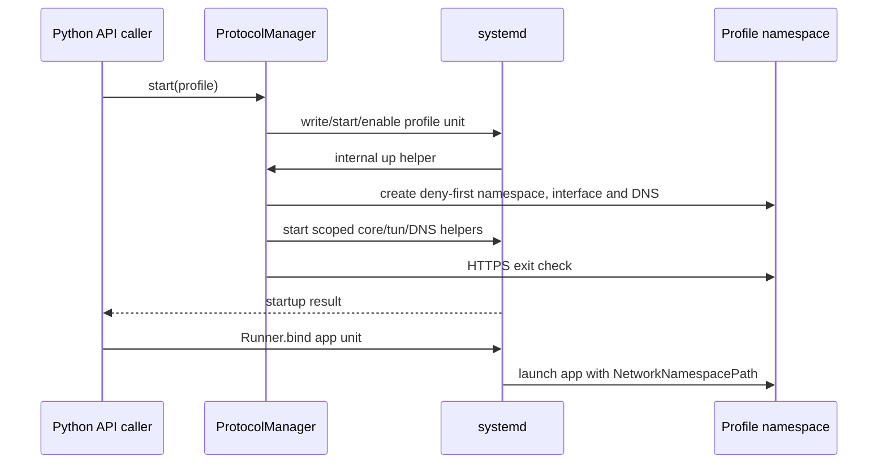

# Architecture and lifecycle

[Home](../README.md) · [Tutorial](GETTING_STARTED.md) · [API](API.md)

The following describes source behavior. Actual kernel/systemd integration and
failure behavior still need Linux testing; diagrams are not validation evidence.

## Control plane versus data plane

The root control plane imports configuration, owns state, creates namespaces,
configures nftables and generates systemd units. Managed applications run as
root or ordinary users with capabilities removed and `NoNewPrivileges=yes`.



Each profile has one shared namespace. Multiple assigned apps share that
namespace's network interfaces, addresses, local listeners and aggregate
counters. It is not a separate namespace per application, nor a complete
container sandbox.

## Owned names and address space

IDs are eight lowercase hexadecimal characters. Display names are not used as
interface names or directly interpolated into shell commands.

| Resource | Naming / allocation |
| --- | --- |
| Namespace | `ns-<profile-id>` |
| Host veth | `veth-h-<profile-id>` |
| Namespace veth | `veth-n-<profile-id>` |
| WireGuard interface | `wg-<profile-id>` |
| Proxy/OpenVPN TUN | `tun-<profile-id>` |
| Host nftables table | `inet sf_<profile-id>` |
| Namespace nftables table | `inet splitforge` |
| Host route table | `20000 + slot` |
| Destination-rule priority | `12000 + slot` |
| Address allocation | Four-address subnet at `10.203.0.0 + slot * 4` |
| Valid slots | 1 through 4095 |

The first slot is `10.203.0.4/30`; the host gets `.5` and the namespace `.6`.
The highest slot is `10.203.63.252/30`. The implementation rejects overlap with
existing non-default IPv4 host routes across route tables and checks occupied
policy slots/resource names. It does not automatically search another address
pool when a network conflict occurs.

## Host routing ownership

The host veth address is added with `noprefixroute` to avoid an IPv4 connected
route in table `main`. IPv6 is disabled on this host veth before it is brought
up. A `/32` peer route is placed in the dedicated table, and a destination-only
rule selects it for traffic to that profile's namespace peer.

This design intends to preserve the existing host main/default route. It still
adds host-local addresses, policy rules and owned nftables tables. It does not
mean zero host networking changes or certified SSH protection. Existing policy
rules, firewalls, cloud filters and unusual routing can conflict; startup probes
may fail instead of establishing connectivity.

The host-owned nftables table limits access to the proxy gateway and rejects
general forwarding involving the profile veth. A source-scoped masquerade rule
is present, but current allowed traffic does not use the veth as a general NAT
internet gateway. The engine does not enable global IPv4 forwarding.

## Protocol paths

### WireGuard

The interface is created in the host namespace and configured through `wg`, then
moved into the profile namespace before assigning IPv4 addresses and its default
route. WireGuard's encrypted transport socket remains in its birthplace
namespace, following the upstream
[namespace model](https://www.wireguard.com/netns/).

### OpenVPN

The process and encrypted transport run on the host. `--route-noexec` and
`--ifconfig-noexec` prevent automatic host route/address changes. A generated
up-hook validates the intended namespace/interface, moves TUN, and applies the
IPv4 address/default route inside the namespace. Existing files/scripts from a
provider config are not trusted as arbitrary host setup commands.

OpenVPN lifecycle/reconnect/topology behavior needs live testing against actual
servers. See the [adapter restrictions](PROTOCOLS.md#openvpn).

### Proxy profiles

```text
namespace app
   → namespace TUN
   → namespace tun2socks
   → veth-connected host gateway:1080
   → host Xray SOCKS inbound
   → selected proxy outbound
   → remote egress
```

For DNSTT/Slipstream, Xray's outbound is SOCKS-over-the-local-TCP-forwarder. That
forwarder reaches a remote SOCKS5 service through the DNS tunnel. Their adapter
blocks non-loopback application UDP. Host-side TCP listener ownership is checked
against the expected systemd service PID/socket, rather than trusting whichever
process happened to bind the port.

## Firewall and DNS guards

The namespace deny policy is installed before connecting the host veth. It:

- Allows loopback, including the namespace DNS stub.
- Rejects IPv6 data-plane output.
- Allows output on the configured tunnel interface.
- For proxy profiles, narrowly permits the host gateway's SOCKS port.
- Rejects general namespace forwarding and other output.
- For TCP-only DNS-tunnel adapters, rejects non-loopback UDP before tunnel output.

It deliberately does not grant all established connections an output exemption
that could bypass the egress-interface checks. Losing the tunnel should leave
traffic blocked; it does not install a secondary Direct default route. This
behavior is exercised by local Linux namespace/core-loss tests; see
[the validation record](VALIDATION.md) for scope and remaining coverage.

The local DNS stub accepts UDP/TCP requests up to its size limit and makes
certificate-verified HTTPS requests to the configured bootstrap IP. Both worker
threads and outstanding requests are bounded. Its resolver file points to
`127.0.0.53`; namespace `nsswitch.conf` uses `hosts: files dns`.

Systemd namespace properties bind the resolver/NSS files and mask selected host
resolver IPC paths. External local proxies, arbitrary Unix sockets and hostile
privileged processes are beyond a network namespace's complete containment
boundary. See [Security](../SECURITY.md).

Because profiles share namespaces, individual tunneled apps cannot disable DNS
isolation or the kill switch independently. The runner rejects those settings.

## State and locks

Default state is `/etc/splitforge/state.json`, with schema `version: 1` and
`profiles`, `apps`, `users` objects. Configuration secrets are stored as plaintext
within this protected file; there is no encryption at rest.

Writes use a same-directory temporary file, mode 0600, file fsync, atomic rename
and directory fsync. File locks serialize mutations across processes; scoped
app-operation locks avoid holding the global state lock while systemd may start
a profile helper. Snapshot reads consume a coherent atomically replaced document
without waiting for slow tunnel startup. Reads validate models/references and
refuse an unsupported schema rather than resetting it.

Persisted `enabled`, exit IP, country and latency are recorded state, not live
process/health truth. Keep root ownership/permissions on the parent paths.

## Systemd resources and reboot

| Unit | Purpose |
| --- | --- |
| `splitforge-profile-ID.service` | Persistent oneshot/remain-active up/down orchestration; enabled by `start()` |
| `splitforge-core-ID.service` | Transient Xray/OpenVPN process |
| `splitforge-transport-ID.service` | Transient DNSTT/Slipstream forwarder |
| `splitforge-tun-ID.service` | Transient namespace tun2socks process |
| `splitforge-dns-ID.service` | Transient namespace DNS stub |
| `splitforge-probe-RANDOM.service` | Short-lived HTTPS reachability probe |
| `splitforge-app-ID.service` | Persistent generated application service |
| `splitforge-exec-RANDOM.service` | One-off execution |
| `splitforge-proxy-RANDOM.service` | TCP-only proxychains wrapper |

Generated apps use `BindsTo=` and `After=` for the profile. Profile stop can stop
dependent workloads before namespace teardown. Core helper units belong to the
profile through `PartOf=`. Their automatic restart behavior is not a complete
end-to-end tunnel-health watchdog; OpenVPN is intentionally not given the same
automatic core restart policy as Xray.

At boot, persistent profile units must recreate ephemeral namespaces/runtime
files and transient helpers. This requires the same stable Python executable,
importable package, dependencies, state, external credentials and network
readiness. Reboot recovery is not yet verified. Bringing a stopped profile back
does not automatically start all workloads that were stopped with it.

## Reassignment transaction

1. Resolve/start the destination profile.
2. Lock the application operation; validate account/service eligibility.
3. Save prior managed configuration and service state.
4. Stop the workload and verify it no longer reports active.
5. Write the new unit/drop-in, reload systemd and optionally start/enable it.
6. Save the assignment. On failure, attempt to restore the old configuration,
   enable state, running state and saved binding.

This transaction cannot preserve application memory, open sockets or arbitrary
external side effects. If restoration fails, the API reports failure and the
operator must inspect the stopped/failed unit.
