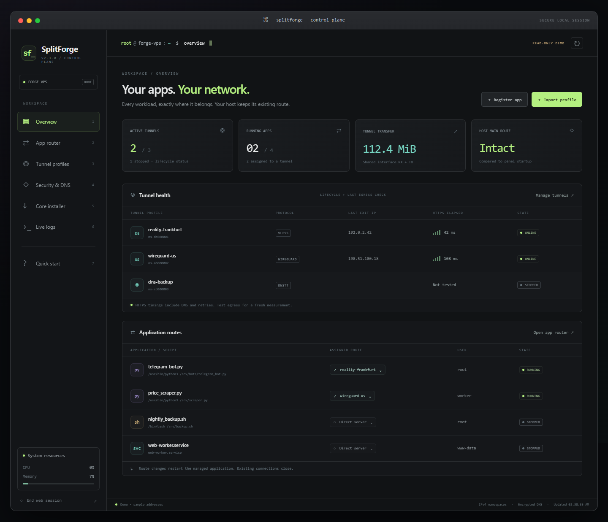

# Web control panel

[English README](../README.md) · [راهنمای فارسی](README.fa.md) · [Security](../SECURITY.md)

SplitForge 2.3 adds a browser control plane styled like a macOS Terminal window:
traffic lights, a command prompt, a dark workspace and green/teal status details.
The networking engine still runs on Linux. Use any modern desktop browser on
macOS, Linux or Windows; a responsive layout supports narrow/mobile screens.



## Start on your VPS

### Automatic first launch (2.4+)

Run this in an interactive SSH terminal:

```sh
sudo splitforge web
```

Before serving the panel, the first-run wizard asks about public/local access,
SSL/HTTPS, domain or IP, the address, optional email, certificate subscriber terms
and the panel port. It starts/enables `splitforge-web.service`; closing SSH no
longer stops the panel. Subsequent interactive `splitforge web` starts the saved
service and prints its address. To change these choices:

```sh
sudo splitforge web setup
```

For unattended configuration, supply the choices explicitly:

```sh
sudo splitforge web setup --address panel.example.com --port 443 --email admin@example.com --agree-tos
sudo splitforge web setup --address YOUR_PUBLIC_IP --port 9090 --agree-tos
# Local HTTP, with access through an SSH tunnel:
sudo splitforge web setup --local --port 9090
# Explicitly select unencrypted public HTTP:
sudo splitforge web setup --address YOUR_PUBLIC_IP --port 9090 --no-tls
```

Replace `YOUR_PUBLIC_IP` with the server's globally routable IP. Domains must
resolve to this server. HTTPS issuance/renewal needs **inbound port 80** for
HTTP-01 validation, even when the panel uses 443/9090. The chosen panel port
must also be reachable. Active UFW receives the necessary TCP allow rules;
cloud/provider firewalls and other firewall managers need your own rules.
Setup adds its own nginx virtual host and does not change host routing.

Certbot 5.4+ is installed into `/opt/splitforge-certbot`, separately from the app.
IP certificates use `--ip-address` and the `shortlived` ACME profile, with no
self-signed fallback. They last about six days; `splitforge-web-renew.timer`
checks twice daily and reloads nginx after renewal. See the
[official Certbot IP-certificate procedure](https://letsencrypt.org/2026/03/11/shorter-certs-certbot/).
Issuance depends on the CA and public reachability. Certificate/startup failure
restores prior owned nginx/service/configuration files and service activation.
Installed packages and issued certificate artifacts remain after rollback.

Private configuration is saved to `/etc/splitforge/web.json`. Python listens on
loopback port 8765, separately from the public port; use `--backend-port` if that
internal port is occupied. The public proxy validates Host and Origin before
forwarding to Python. Its file is `/etc/nginx/conf.d/splitforge-web.conf`. The
known legacy SplitForge proxy can be migrated with a private backup; unrelated
unmanaged proxy files are not overwritten.

```sh
sudo systemctl status splitforge-web.service --no-pager
sudo systemctl status splitforge-web-renew.timer --no-pager
sudo journalctl -u splitforge-web.service --no-pager -n 50
sudo cat /etc/splitforge/web.token
```

Open the printed URL and enter the token. Never share it. Explicit public HTTP
exposes credential/session traffic to observers; local HTTP uses SSH encryption.
Use the setup-managed proxy for direct public access, retaining its protections.

### Foreground mode / SSH forwarding

To skip the wizard and run the loopback backend in the foreground:

```sh
sudo splitforge update
sudo splitforge web --foreground
```

The panel listens on `127.0.0.1:8765`. On first start it creates a random access
token in `/etc/splitforge/web.token`, mode 0600. Read it in another SSH terminal:

```sh
sudo cat /etc/splitforge/web.token
```

Keep the first terminal running. On your own computer, establish an SSH forward
to your VPS (replace the example hostname):

```sh
ssh -N -L 8765:127.0.0.1:8765 root@YOUR_VPS_HOST
```

Visit [http://127.0.0.1:8765](http://127.0.0.1:8765) in your local browser and
paste the token into the sign-in form. Use the same local/remote port; request
Host and Origin are checked. The panel intentionally rejects public binding
such as `--host 0.0.0.0`. Do not expose this root control plane through a public
port/proxy. The SSH connection encrypts traffic between your computer and VPS.

If `update` is unavailable in an older installation, bootstrap once with the
[manual upgrade procedure](GETTING_STARTED.md#replace-and-upgrade).

## Preview without root or credentials

```sh
splitforge web --demo
```

Click **Explore read-only demo**. It uses documentation IP addresses and sample
workloads. Forms and navigation work, but mutation requests are rejected; no
profiles, commands or downloads run. Installed-core detection and system-resource
readouts describe the local machine. Native macOS/Windows can preview this UI
after installing the Python package; actual network management requires Linux.

## What you can manage

| Page | Controls |
| --- | --- |
| Overview | Profile lifecycle, last exit/IP timing, shared tunnel transfer, running workloads and host main-route comparison |
| App router | Register scripts/binaries/services; browse server files; assign Direct or a profile; start, stop and remove |
| Tunnel profiles | URI/file imports, DNSTT/Slipstream wizard, replacement of stopped profiles, start, test, stop and remove |
| Security & DNS | Mandatory guard explanation; per-profile verified DoH URL/bootstrap settings |
| Core installer | Select components, automatically include proxy helpers, skip installed binaries, inspect individual results |
| Live logs | Follow the SplitForge systemd journal and recent operation messages |
| Quick start | Six-step English/Persian guide |

Keyboard 1–7 switches pages when focus is outside a form. On mobile, the menu
button opens the sidebar. Wide tables scroll within their panels. Escape closes
dialogs. Search filters app names/commands/users or profile names/protocols.

Profile import accepts a URI or a **path on the VPS**, not a browser-local file.
Use the server file browser or transfer provider files privately beforehand.
The browser never receives saved profile configs/private keys. Replacement needs
a fresh source and preserves the existing ID/assignments. DNSTT public keys are
hex; Slipstream's pinned certificate path must exist on the server.

For scripts, check the command, Linux account and working directory; use your
app's own Python venv when needed. Root is supported with the runner's existing
privilege hardening. A file choice does not move an existing process. Registering
does not start the workload: assign its route to start it. Switching routes is a
restart and loses open connections/process memory. Direct removes tunnel routing.

Stopping a profile can stop its dependent workloads. Reassign/remove all app
and user references before deleting it. Starting a profile does not automatically
restart every app stopped with it; use App Router deliberately.

## Jobs, refresh and failure behavior

### Automatic application tunnel backup

In App Router, open the route selector, choose a primary tunnel and an optional
**Automatic backup tunnel**, then apply. Direct has no backup setting. Selecting
a backup installs/enables a separate systemd monitor for this state file; it
continues after closing the browser, web panel or SSH connection.

```sh
sudo splitforge bind telegram-bot --profile wg-europe --backup vless-backup
# Explicitly choose a single route again, removing the automatic policy:
sudo splitforge bind telegram-bot --profile wg-europe
```

The monitor scans enabled policies at 15-second intervals and requires two
consecutive failed health checks. A health check verifies lifecycle, namespace
guard/route/DNS configuration and real namespace HTTPS/DNS egress. Network probe
timeouts and backup startup add to detection/switch time; this is not an instant
packet-level or connection-preserving migration.

If the primary cannot start when the policy is first applied, a validated backup
can be used immediately. If both startup attempts fail, a stopped, tunneled unit
and the enabled policy are saved for later recovery; the previous Direct service
is not retained as the completed assignment.

Failover stops and restarts the managed program in the selected backup namespace;
open connections and memory are lost. The backup starts automatically if needed.
If neither configured tunnel is healthy, the app stays stopped with its enabled
intent retained, allowing later recovery. The monitor never selects Direct.
An explicitly stopped app is ignored. Stopping a tunnel while its app policy is
enabled can trigger failover; stop the app or remove its policy to prevent that.

A healthy backup is kept to avoid repeated restarts. Reapply the primary in the
selector to move back, or it can become the fallback if the backup later fails.
Manual assignment/stop changes override stale probe results. Both primary and
backup references must be removed before deleting a profile. Upgrade maintenance
stops the monitor before stopping workloads; `restore` reinstates saved policies.
Monitor messages are available in Live logs under `splitforge-failover-*` units.

### Health checks and repair

In **Live logs**, choose **Check health** for a read-only scan or **Check & repair**
for explicitly approved repairs. Results include category/scope, error or warning,
an explanation, suggested next step and a repaired badge when applicable.

Checks cover required cores, systemd/TUN, saved enabled workloads, each active
tunnel's lifecycle, default route, namespace/host guard, DNS files and a fresh
namespace HTTPS/DNS probe. Stopped, unneeded profiles are left stopped. Web
listeners and the certificate renewal timer are checked when `web setup` has
saved a deployment. Host DNS and the startup host-route baseline are also checked.

Repair installs missing required cores, rebuilds inconsistent managed tunnel
namespaces, and restarts their saved enabled applications inside the same assigned
tunnel. Open connections close; this restart is stated in the confirmation.
Managed nginx configuration/renewal scheduling may be reactivated. Host routing,
SSH, host resolver configuration and provider firewall policies are not reset.
The worker cannot restart its own web service; service/configuration failures
include commands or setup instructions for the operator.

A successful check job means the scan completed, not that all checks passed.
Review its error/warning counts. External/cloud firewall behavior cannot be
proven by checking the local host; this is shown as a warning requiring an
independent connection. Protocol/provider failures still require valid remote
servers and credentials. The result/history is kept in memory until panel restart.

Mutations run sequentially in a background worker and return a job ID immediately.
The UI polls state every three seconds. The operation banner and job messages
show progress; simultaneous mutations receive a busy response. DNS/core selection
forms are not reset by polling. Session expiry or logout requires signing in again.

Active unit state is not a fresh connectivity test; use **Test egress** after
starting a profile. Timing includes DNS/TLS/HTTPS/retries. Byte counters are shared
by all apps using a profile and reset when its interface is recreated. Host route
comparison checks the main IPv4 table against panel startup, not every SSH failure
mode or policy/firewall rule on the machine.

Core installs use the existing checksum-verified installer. An individual failure
does not remove successful installs, and remaining selected cores are attempted.
Reopen the checklist to retry missing items. Detection means an executable is on
PATH, not that its version or upstream connection is healthy. Source builds can
take several minutes. Closing a browser does not cancel a submitted operation.

Downloads stream with byte limits and real progress percentages when the server
supplies a total size. Unknown-length transfers and source compilation are
indeterminate; completion is not fabricated. Transient network/408/429/5xx
failures get up to three attempts per source. Go uses its official distribution
mirrors; GitHub release downloads can use the matching official release asset API.
The same pinned SHA-256 is mandatory for every source; invalid content is never
installed or cached. A permanent HTTP failure moves to the next official source.

Verified artifacts are cached privately in `/var/cache/splitforge-downloads`
using the expected digest plus filename. Future installs can reuse them offline.
The existing `SPLITFORGE_DOWNLOAD_CACHE` environment setting also accepts
pre-fetched files named like the original archive; those must match the pinned
digest too. A corrupt cache is reported rather than trusted. An unwritable cache
does not discard a successful verified network transfer. Cache contents can be
removed separately when you need disk space; installed executables are retained.

Ctrl+C stops a foreground panel after waiting for the active operation. Managed
workloads continue running when the web panel exits. Job history and sessions are
in memory; restarting the panel clears them. Profile/app state remains on disk.

## Custom options

### English / فارسی

Use the language button in the title bar before or after login. Open dialogs have
their own button because native modal dialogs block controls behind them. The
choice applies to every page, form, navigation label, help lesson, diagnostic
finding/remedy, progress summary and error guidance. Persian uses RTL; commands,
IP addresses and technical output retain LTR where needed. Only the language
preference is stored in browser local storage. Switching preserves current form
values and does not change server configuration.

Raw systemd journals, upstream technical errors, paths, core names, commands and
user-provided names retain their original spelling. Operation cards offer
expandable **Technical details** underneath localized status/error guidance.
Unrecognized upstream failures receive localized guidance by error category;
their original details are retained for troubleshooting.

### Encrypted backup and recovery

**Security & DNS** includes encrypted export/download and file restore forms.
Restore replaces current registrations, retains panel access and leaves imported
workloads stopped. CLI commands also offer explicit startup, web redeployment
and previous-version rollback. Read [Backups and rollback](BACKUPS.md) for the
archive contents, password handling, recovery behavior and maintenance limits.

### Traffic & quotas

The eighth navigation page shows independent per-service app counters and real
tunnel interface graphs. Set a manual usage budget, warning threshold or reset
the usage period; blocked targets require an explicit restart after adjustment.
Collection is a permanent service. Read [Traffic and budgets](TRAFFIC.md) for
kernel requirements, counter scope, crash recovery and sampled-stop overshoot.

### Verify an application's actual route

In **App router**, start the workload and click **Test route**. The check pins
the main process's network and mount namespace descriptors, verifies that the
actual network matches its saved assignment, and runs a capability-free HTTPS
and DNS check as the registered user. It reads that mount namespace's
`resolv.conf`, so it also tests the application's isolated DNS view. Direct
workloads are checked in their actual host namespace. No proxy environment or
host fallback is inherited. The profile's verified HTTPS probe/CA settings are
used for tunneled workloads; Direct uses Cloudflare's trace endpoint.

```sh
sudo splitforge app test my-worker
```

Results show exit IP, configured DNS servers, resolved probe addresses, PID,
namespace identities, HTTPS elapsed time and timestamp. A stopped, restarting
or reassigned application fails the check. Services with `RootDirectory`/chroot
are explicitly unsupported because the probe interpreter/trust store may differ.
This verifies a fresh connection in those namespaces; it does not inspect
existing sockets, application-specific proxy settings or separate child
namespaces. Results are historical, not continuous monitoring, and disappear
when the panel restarts. `nsenter` and `setpriv` come from Ubuntu/Debian util-linux.

```sh
sudo splitforge --state /root/private/state.json web --foreground --port 9000 --token-file /root/private/web.token
```

Forward port 9000 to port 9000 in that case. Global `--state` precedes `web`.
Existing token files must be regular files owned by the server user, mode 0600,
containing 32–256 ASCII non-whitespace characters. A restart invalidates all
sessions. To rotate access, stop the panel, replace the file with a fresh random
token under those permissions, then restart it. The server does not print tokens
or place them in URLs/browser local storage.

## Manual persistent systemd service (advanced)

Create `/etc/systemd/system/splitforge-web.service` with your editor:

```ini
[Unit]
Description=SplitForge local web control panel
After=network-online.target
Wants=network-online.target

[Service]
Type=simple
User=root
ExecStart=/usr/local/bin/splitforge web --foreground --host 127.0.0.1 --port 8765
Restart=on-failure
RestartSec=3
UMask=0077
KillSignal=SIGINT
KillMode=mixed
TimeoutStopSec=30min

[Install]
WantedBy=multi-user.target
```

```sh
sudo systemctl daemon-reload
sudo systemctl enable --now splitforge-web.service
sudo journalctl -u splitforge-web.service --no-pager -n 50
```

The initial stop signal goes to the Python server so it can finish a job before
exiting. Wait for jobs to finish before upgrades, then restart the web service
after updating the package. It remains bound to loopback; keep using SSH forwarding.

## Trust boundary and verification

An administrator token grants management authority over root workloads. Treat it
like an SSH credential. Sessions use HttpOnly/SameSite cookies, CSRF tokens,
Host/Origin checks and a bounded sign-in failure rate. Assets are packaged locally;
there are no external script/font/CDN dependencies. Responses disable caching and
framing. Public access uses the setup-managed proxy. This is an administrator
interface without separate roles, not an externally audited hosting platform.

Tests cover HTTP auth/session expiry/logout, CSRF/origin/host rejection, demo
no-mutation behavior, request limits, secret filtering and serialized jobs. An
opt-in Linux test manages a real root systemd service via authenticated HTTP.
Playwright checks browser forms, file browsing, DNS edits surviving polling,
XSS escaping, logs, Persian help, mobile navigation and logout. See
[the validation record](VALIDATION.md) for commands and limits.
